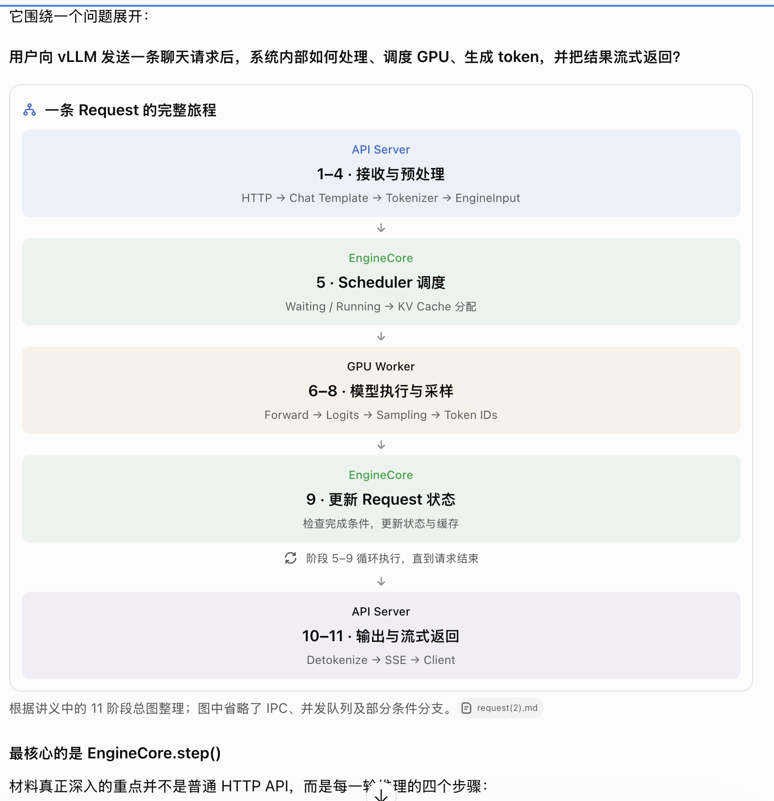

# Date 3 — Topic vllm request的生命周期

## Today: What I Done
- 整理了vllm小课堂的学习资料，重点看了第三章
- 

## Tomorrow: To Do
- 读request进来的调用链，尤其是EngineCore.step()，Scheduler / KV Cache，理解state如何变化
- 

## Notes

### vllm小课堂只看这些
这三个主题与你目前的 mini-SGLang 学习目标最接近，但学习深度应该不同。
03

一个 Request 的完整旅程

第一优先级 · 建议 2–3 小时

重点理解 API Server、EngineCore、GPU Worker 的边界，以及 Scheduler、KV Cache、模型执行、Sampling 如何组成循环。

学习目标： 能追踪一个 request 从输入到输出的完整流程。

10

KV Connector 的前世今生

第二优先级 · 首轮建议 1–2 小时

材料讲 KV Cache 外部化、Scheduler 与 Worker 的职责解耦、异步数据传输以及 LMCache/Mooncake。

你先读第一、二节，重点回答：缓存为什么要复用？调度器怎么知道哪些 token 已经计算？为什么数据传输与调度决策要分离？

暂时跳过： RDMA、CudaIPC、零拷贝传输的实现细节。

01

如何在 vLLM 中接入一个模型

选择性学习 · 首轮 45–60 分钟

重点看 Hugging Face 模型与 vLLM Runtime 的接口差别、forward()、Embedding、Attention，以及如何验证模型正确运行。

这篇的完整学习门槛其实比较高，需要熟悉 PyTorch nn.Module、state_dict、权重加载和 Tensor Parallelism。

现在只建立概念，不要求完成真实模型移植。

### 
读完后，你应该能够：

建立 API Server、Engine Core、GPU Worker 三个执行边界的全局模型；
理解请求为何要拆成 EngineInput 与 SamplingParams；
追踪 SchedulerOutput、InputBatch、ModelRunnerOutput、EngineCoreOutputs 和 RequestOutput 的转换；
解释 continuous batching 如何由调度决策、KV Cache 与持久化批状态共同支撑；
定位模型前向、结构化约束、采样及 CPU/GPU 同步发生的位置；
理解共享输出循环如何把批量结果路由给逐请求生成器；
判断结构化输出、投机解码、取消、LoRA 和并行拓扑怎样约束主循环；
分清架构事实、合理推断与材料没有支持的性能结论。

### 

### 

### 

## 🔥 Failure Hypotheses

## 🔗 Systems Analogy

## 🧠 Mental Model Update
Request Lifecycle → Scheduler / Continuous Batching → KV Cache → Prefill / Decode → 性能测量 → 高级分布式优化。