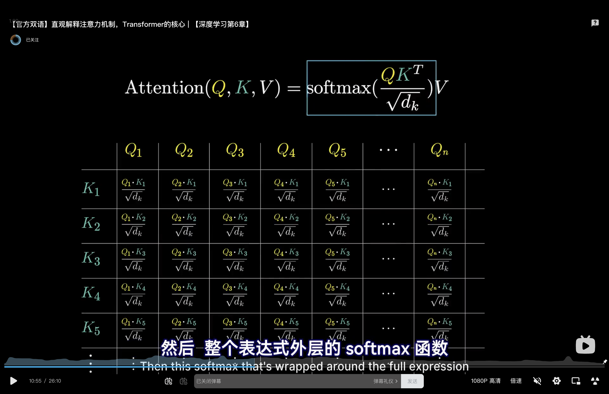
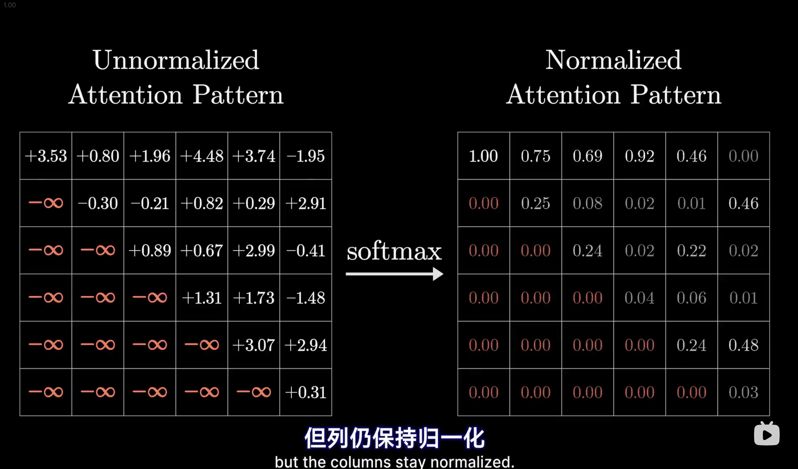
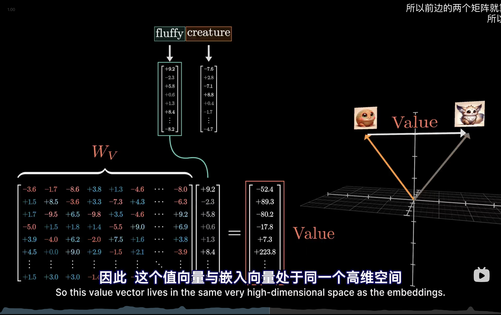

# Date 1025 — finish tinyllm lab1

## Today: What I Done
- recap previous note and context
- 

## Tomorrow: To Do
- 
- 

## Notes

### 
【官方双语】直观解释注意力机制，Transformer的核心 | 【深度学习第6章】
visualize and so elegant
https://www.bilibili.com/video/BV1TZ421j7Ke/?spm_id_from=333.1387.homepage.video_card.click&vd_source=fdeeda7e821158681d7294658a429bc1

masking

### 

### 

### 

### 

## 🔥 Failure Hypotheses
连续学习不应该被面试打断
二元事件 vs 持续积累

## 🔗 Systems Analogy

## 🧠 Mental Model Update